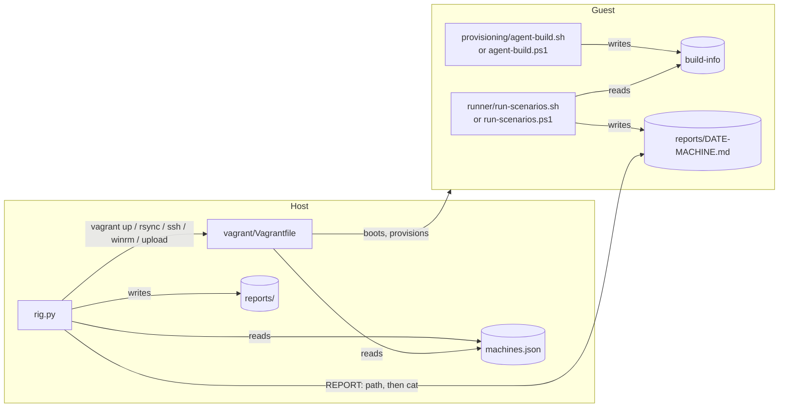

# Architecture

The rig has two halves. On the host, [`rig.py`](../rig.py) reads the machine catalog and
drives Vagrant. In the guest, plain bash or PowerShell scripts build the agent and run the
scenarios. The two halves meet in three places only: the synced sources, one command line
per step, and the report file the guest writes. Everything the guest does can therefore also
be run by hand over `vagrant ssh`, plain SSH or WinRM, which is how a failing step is
debugged.



## Host side

| File | Role |
| --- | --- |
| [`rig.py`](../rig.py) | The CLI: `list`, `up`, `build`, `run`, `report`, `down`, `check`. Python 3.10+, standard library only, so it runs on any host without a virtualenv. |
| [`tools/riglib.py`](../tools/riglib.py) | What `rig.py` and [`tools/offline_bundle.py`](../tools/offline_bundle.py) share: the rig's paths, the provider choice, the vagrant wrappers, the exit-code convention. |
| [`machines.json`](../machines.json) | The one machine catalog. Read by both `rig.py` and the Vagrantfile, so nothing else lists machines. See [machines.md](machines.md). |
| [`vagrant/Vagrantfile`](../vagrant/Vagrantfile) | Turns the catalog into Vagrant machines on every provider: boxes, resources, synced folders, provisioners. |
| [`justfile`](../justfile) | Optional shorthands: `just up debian12` is `python3 rig.py up debian12`. |

### Paths and the root

[`riglib`](../tools/riglib.py) fixes three paths:

- `RIG`: this checkout.
- `ROOT`: the directory holding `agent/`, `rules/` and `scenarios/` (and `server/` when
  present). It is `RIG_ROOT`, else `SYNTHAEA_ROOT`, else the parent of the rig checkout.
  `rig.py` passes it to Vagrant as `RIG_ROOT`, so the Vagrantfile resolves the same root.
- `VAGRANT_DIR`: `rig/vagrant`, the working directory of every vagrant call.

`up`, `build` and `run` stop with exit code 2 when `agent`, `rules` or `scenarios` is
missing from the root ([`need_siblings`](../rig.py)). `server` is optional.

### Provider choice

[`provider()`](../tools/riglib.py) picks the Vagrant provider for the host: `hyperv` on
Windows, `qemu` on Apple Silicon macOS, `virtualbox` on Intel macOS, `libvirt` elsewhere.
`RIG_PROVIDER` overrides it. Every vagrant call runs with `VAGRANT_DEFAULT_PROVIDER` set to
that value and, on Hyper-V, `VAGRANT_HYPERV_SWITCH=Default Switch` unless already set
([`vagrant_env`](../tools/riglib.py)). A machine with no box for the chosen provider is
refused before Vagrant runs ([`machine`](../rig.py)).

## Guest side

| Directory | Runs in the guest | Role |
| --- | --- | --- |
| [`provisioning/`](../provisioning/) | as Vagrant provisioners, or from `rig.py build` | Host setup (swap, job cap), box fix-ups, the ONNX Runtime compatibility step, the agent build. See [provisioning.md](provisioning.md). |
| [`runner/`](../runner/) | from `rig.py run` | The scenario runners and their catalogs. See [scenario-runs.md](scenario-runs.md). |
| [`tools/`](../tools/) | by hand | Diagnostics ([`diagnose-ebpf-toolchain.sh`](../tools/diagnose-ebpf-toolchain.sh)) and Windows capture scripts. |
| [`powershell/RigCommon.ps1`](../powershell/RigCommon.ps1) | dot-sourced | The admin check and summary writer every PowerShell script shares. |

The toolchain provisioning itself (rustup, the eBPF nightly, bpf-linker, MSVC Build Tools)
is not in the rig: it lives in the agent checkout, under
[`packaging/toolchain/`](https://github.com/synthaea-lab/agent/tree/main/packaging/toolchain),
next to the code it builds. The catalog's `provision` field points at it.

## The commands, step by step

### `up <machine>`

Checks the machine and the checkouts, then runs `vagrant up <machine> --provider <provider>`
from `vagrant/`. The first boot downloads the box and runs every provisioner (see
[provisioning.md](provisioning.md#provisioners)); later `up` calls only resume the VM.

### `build <machine> [--offline] [--ort auto|prebuilt|static] [--ort-compat] [--dry-run]`

1. Computes the source description ([`source_info`](../rig.py)): one
   `<checkout> <short sha>[+dirty]` entry per checkout present, for example
   `agent e352603, rules 9aaac6a, scenarios 0496952, rig 1b2edf8`. `+dirty` means tracked
   files differ from `HEAD`; untracked files are not counted. The guest has no `.git`, so
   this string is the only record of what was built.
2. Syncs the sources ([`sync`](../rig.py), below).
3. With `--offline` on a Linux guest, runs `tools/offline_bundle.py --push <machine>`
   ([offline-builds.md](offline-builds.md)).
4. Runs the build script in the guest: `provisioning/agent-build.sh` with the flags and
   `SYNTHAEA_SOURCE` set to the source description, or `provisioning/agent-build.ps1
   -Source <description>` on Windows. The Windows build takes no ONNX Runtime or offline
   options; `rig.py` drops them for Windows guests.

`--dry-run` prints the vagrant command line of step 4 and stops before syncing:

```console
$ python3 rig.py build debian12 --offline --ort-compat --dry-run
+ (vagrant/) vagrant ssh debian12 --command SYNTHAEA_SOURCE='agent e352603, rules 9aaac6a, scenarios 0496952, rig 020f42d' bash /synthaea/rig/provisioning/agent-build.sh --ort auto --offline --ort-compat
(dry run: nothing synced or run)
```

### `run <machine> [scenario ...] [--dry-run]`

1. Computes the source description again (the sources at run time may differ from those at
   build time; the report shows both).
2. Syncs the sources.
3. Streams `runner/run-scenarios.sh --machine <machine> [scenario ...]` (Linux, with
   `SYNTHAEA_SOURCE`) or `runner/run-scenarios.ps1 -Machine <machine> -Source <description>
   [scenario ...]` (Windows) through `vagrant ssh` or `vagrant winrm`, echoing each line.
4. Keeps the path from the runner's last `REPORT: <path>` line
   ([`cmd_run`](../rig.py)), reads that file back through the same channel
   ([`fetch_report`](../rig.py)) and writes it to `reports/<file name>` with LF line endings.

The exit code is the runner's: 0 when no scenario FAILed or ERRORed, 1 otherwise. When the
runner stops before writing a report (no build, catalog error), `run` reports that and exits
with the runner's code, or 1 if the runner exited 0 without a report line.

### `report [machine]`

Prints the newest file in `reports/` by modification time, of one machine if given
(`*-<machine>.md`), followed by its path, time and up to five older reports. It does not
contact the VM.

### `down <machine> [--destroy]`

`vagrant halt`, or `vagrant destroy --force` with `--destroy`.

### `list` and `check`

`list` prints each machine with its guest, matrix row and the box it uses on this host's
provider. `check` runs every check that needs no VM; see [testing.md](testing.md).

## Syncing the sources

The guest builds the checkouts as they are on disk, uncommitted changes included, which is
what a developer wants when testing a change before committing it.

- **Linux guests** receive each checkout one way by rsync: the rig at `/synthaea/rig`, the
  others at `/synthaea/<name>`. `rig.py` runs `vagrant rsync <machine>`; the folders and
  their excludes are declared in the Vagrantfile ([machines.md](machines.md#synced-folders)).
- **Windows guests** have no synced folder (WinRM). `rig.py` zips the files git knows of in
  each checkout (`git ls-files --cached --others --exclude-standard`: tracked files plus
  untracked files that are not ignored) into `.offline/synthaea-src.zip`, uploads it to
  `C:\synthaea-src.zip` and expands it over `C:\synthaea`.

## Quoting the guest command

`rig.py` sends each step as one command line, which the guest's shell parses again. The
source description contains spaces and commas, a root path may contain anything, and on
Windows the line passes through PowerShell's parser. [`Guest`](../rig.py) builds that line:

- In Linux guests every argument is quoted with `shlex.quote`, and environment variables are
  prefixed as `NAME=value` assignments (names checked against `[A-Za-z_][A-Za-z0-9_]*`).
- In Windows guests an argument made only of characters PowerShell reads as one bare word is
  left bare; anything else is single-quoted, with every kind of single quote PowerShell
  recognizes (`'`, `‘`, `’`, `‚`, `‛`) doubled. Windows scripts take parameters, never
  environment variables.
- A switch (`--machine`, `-Source`) is marked as a `Flag` and stays bare; anything that does
  not look like a switch is refused rather than sent unquoted.

[`tests/test_rig.py`](../tests/test_rig.py) pins the exact command lines for both guests.

## State

| Where | What | Written by |
| --- | --- | --- |
| `rig/reports/` | Fetched reports, `<date>-<machine>.md`; ignored by git | `rig.py run` |
| `rig/.offline/` | Offline bundles and the Windows source zip; ignored by git | `offline_bundle.py`, `rig.py build/run` |
| `rig/vagrant/.vagrant/` | Vagrant's machine state and generated SSH keys | Vagrant |
| `~/synthaea-rig/` (Linux guest) | `build-info`, `build.log`, `status.txt`, `runs/<stamp>/`, `reports/` | `agent-build.sh`, `run-scenarios.sh` |
| `~/synthaea-offline/` (Linux guest) | The unpacked offline bundle and its private `CARGO_HOME` | `agent-build.sh --offline` |
| `C:\synthaea-rig\` (Windows guest) | `build-info`, `build.log`, `runs\<stamp>\`, `reports\` | `agent-build.ps1`, `run-scenarios.ps1` |

`RIG_STATE` (Linux) or `-State` (Windows) moves the guest state directory. The raw material
of a run (agent log, scenario output, alerts, events) stays in the guest; only the report
comes back to the host.

## Exit codes

Every rig tool, Python or bash, exits with the same three codes so that `rig.py`, a CI job or
a shell loop can tell a failure from a run that never started:

| Code | Meaning | Examples |
| --- | --- | --- |
| 0 | OK | No scenario FAILed or ERRORed (PASS, UNEXPECTED and SKIP all count as OK), every check passed, the agent is built |
| 1 | The task ran and something failed | A scenario FAILed or ERRORed, a check found a problem, the build failed or has no eBPF probes |
| 2 | The task could not run | Unknown option, command or machine; missing vagrant, bash, checkout or build; no passwordless sudo |

In Python, [`RigError`](../tools/riglib.py) means "cannot run" (2) and its subclass
`CheckFailed` means "ran and failed" (1); [`run_cli`](../tools/riglib.py) prints the message
to stderr and returns the code, and a failed subprocess passes its own code through. In bash,
[`runner/lib/common.sh`](../runner/lib/common.sh) provides `die` (1), `die_usage` and
`die_env` (2), and `need_values` for option arguments. Each script states its exit status in
its header comment. [`tests/test_exit_codes.py`](../tests/test_exit_codes.py) holds the
tools to it.
